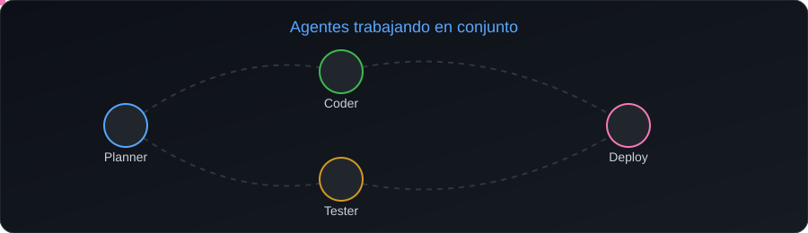

| Agente | Rol |
|:---:|---|
| 🔵 **Planner** | Descompone una tarea en pasos |
| 🟢 **Coder** | Escribe y modifica el código |
| 🟡 **Tester** | Verifica que todo funcione |
| 🩷 **Deploy** | Publica el resultado |

---

## 🧠 Sobre mí

- 🤖 Ingeniero de software enfocado en **agentes de IA**: diseño plataformas donde los LLM orquestan tareas reales con LangChain, LangGraph y n8n
- 🏗️ Construí una plataforma SaaS multi-tenant de orquestación de agentes: **+35% de productividad** y **−28% en costos operativos**
- ⚡ Me interesa que la IA llegue a producción: backends escalables, eventos asíncronos y sistemas en tiempo real
- 🌱 Profundizando en: coordinación entre agentes (LangGraph) y automatización de punta a punta con n8n
- 💬 Pregúntame sobre: integrar LLM en backends, orquestar agentes y arquitecturas con FastAPI, Redis y AWS
- 📫 Contacto: [LinkedIn](https://www.linkedin.com/in/francostv)

## 🛠️ Stack

**IA y automatización**

**Backend y datos**

**Frontend, cloud y DevOps**

## 🚀 Proyectos destacados

| Proyecto | Descripción | Tecnologías |
|---|---|---|
| *(Nombre)* | *(Qué resuelve, en una línea)* | *(stack)* |
| *(Nombre)* | *(Qué resuelve, en una línea)* | *(stack)* |
| *(Nombre)* | *(Qué resuelve, en una línea)* | *(stack)* |

## 📊 Estadísticas de GitHub

 

---

Gracias por pasar por aquí ✨

